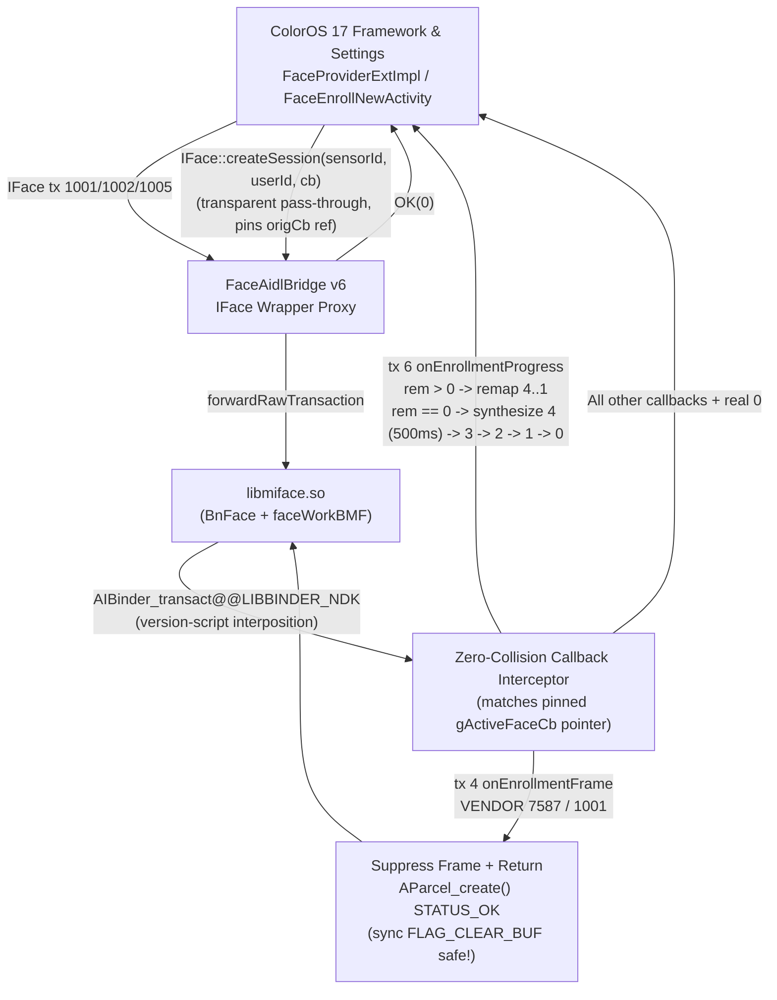

# ColorOS 17 Face Unlock AIDL V1 Bridge (`tanzanite`)

A standalone, zero-`libc++_shared.so` native C++ AIDL V1 Face HAL proxy & linker-interposition bridge that adapts **Xiaomi's `libmiface.so`** (`android.hardware.biometrics.face.IFace/default` + `vendor.xiaomi.hardware.aon.IAlwaysOn/miaonservicebymiface`) to **ColorOS 17 (`FaceProviderExtImpl` & `FaceEnrollNewActivity`)** — enabling fast unlock, ColorOS custom binder commands, full circular enrollment progress animation, and zero crash/auto-cancel issues.

---

## Test Environment & ROM Baseline

| Component | Details |
| :--- | :--- |
| **Test Device** | Redmi Note 14 4G (`tanzanite`, SKU `tanzanite_n_gl`) |
| **SoC / ABI** | MediaTek Helio G99-Ultra (`MT6789`), `arm64-v8a`, VNDK 31 |
| **Display** | 1080×2400 AMOLED (`panel_o7_38_0c_0a_dsc_vdo`) |
| **Kernel** | `5.10.269-EvernightKernel-Android-PERMISSIVE` |
| **Stock Firmware (Base Vendor)** | HyperOS 2 — `OS2.0.214.0.VOGEUXM` (`Redmi/tanzanite/tanzanite:12/SP1A.210812.016/OS2.0.214.0.VOGEUXM:user/release-keys`, Android 12 / SDK 31 vendor) |
| **ColorOS Version** | ColorOS 17 (`V17.0.0`, Android 17 / SDK 37) |
| **ColorOS Base ROM** | OnePlus Ace 5 Ultra CN (`PLC110`), `PLC110_11_A.01` (`PLC110_11.A.01_001_202610210112`, `CP2A.260605.016 release-keys`) |
| **Deployment Method** | DSU (`vendor.img` repacked with `mkfs.erofs`) |

---

## What Is Bridged

| Layer | Target / Backend |
| :--- | :--- |
| **Exposed Services** | `android.hardware.biometrics.face.IFace/default` (Stable AIDL V1, wrapped proxy)<br>`vendor.xiaomi.hardware.aon.IAlwaysOn/miaonservicebymiface` (pass-through) |
| **ColorOS Custom Transactions** | `IFace` tx `1001` (`updateSettingSwitchStatus`), tx `1002` (`sendFaceCmd`), tx `1005` (`updateDynamicallyLog`), and fallback `1000..0x00ffff00` |
| **Outbound Callback Interception** | `ISessionCallback::onEnrollmentFrame` (tx `4`), `onError` (tx `5`), `onEnrollmentProgress` (tx `6`), `onAuthenticationSucceeded` (tx `7`), `onAuthenticationFailed` (tx `8`), `onSessionClosed` (tx `19`) |
| **Underlying Vendor Library** | Stock Xiaomi `/vendor/lib64/libmiface.so` (`miface::service::register_face_service()` & `register_aon_service()`) |
| **Replaces Stock Binary** | `/vendor/bin/hw/mifaced` (only calls `register_face_service()` / `register_aon_service()`, fails ColorOS custom tx, triggers ColorOS 5-strike auto-cancel, and never triggers ColorOS enrollment progress UI) |

---

## Files Bridged / Modified

| File Path | Action | Mode / Owner | SELinux Context |
| :--- | :--- | :--- | :--- |
| `vendor/bin/hw/android.hardware.biometrics.face-service.tanzanite` | **Added** | `0755` (`0:2000`) | `u:object_r:hal_face_default_exec:s0` |
| `vendor/etc/init/miface.rc` | **Replaced** | `0644` (`0:0`) | `u:object_r:vendor_configs_file:s0` |
| `vendor/etc/vintf/manifest/miface.xml` | **Kept / Reference** | `0644` (`0:0`) | `u:object_r:vendor_configs_file:s0` |

### Required Stock Vendor Files (Keep Unmodified from Base Vendor)
- `/vendor/lib64/libmiface.so` (and its stock Xiaomi camera/face dependencies; the binary sets `RUNPATH=/vendor/lib64` and links `libmiface.so` directly).

---

## How the Logic Works

### Why Stock `mifaced` Breaks on ColorOS 17
1. **ColorOS Custom `IFace` Transactions (`1001`, `1002`, `1005`)**: `FaceProviderExtImpl` sends vendor-specific transactions (`updateSettingSwitchStatus`, `sendFaceCmd`, `updateDynamicallyLog`) directly to `IFace/default`, which Xiaomi's `BnFace` rejects with `STATUS_UNKNOWN_TRANSACTION`.
2. **`AIBinder_Class` Descriptor Collision**: If a proxy naively wraps `ISessionCallback` with a second `AIBinder_Class_define("android.hardware.biometrics.face.ISessionCallback", ...)`, it collides with `android.hardware.biometrics.face-V1-ndk_platform.so`'s class inside `libmiface.so`, breaking callback association.
3. **5-Strike Enrollment Auto-Cancel (`VENDOR 7587 / 1001`)**: Xiaomi `libmiface.so` emits internal status frames (`AcquiredInfo::VENDOR = 23`, `vendorCode = 7587` camera-opening and `1001` session-active) via `BpSessionCallback::onEnrollmentFrame()`. ColorOS `ScreenLockFaceEnrollController` does not recognize them and counts them as failures toward its 5-strike auto-cancel limit.
4. **Blank / Missing Enrollment Progress Animation**: ColorOS `FaceEnrollNewActivity` computes `mEnrollProgress = (5 - remaining) / 5.0f` and **only** starts the rect-to-circle preview morph + fade-in (`250 ms` delay + `200 ms` duration) + Lottie progress ring when it receives **`remaining == 4`**. Xiaomi's 2D face HAL completes in a single one-shot `onEnrollmentProgress(id, remaining=0)`, so the UI skips the progress ring entirely.

### Bridge Architecture



### Detailed Implementation Breakdown
1. **Symbol-Versioned Linker Interposition (`src/face_export.map`)**:
   - The executable exports `AServiceManager_addService@@LIBBINDER_NDK`, `AIBinder_transact@@LIBBINDER_NDK`, and `AImage_getPlaneData@@LIBMEDIANDK` via `-rdynamic -Wl,--version-script=src/face_export.map`, resolving the real platform symbols dynamically with `dlsym(RTLD_NEXT, ...)`.
   - When `miface::service::register_face_service()` calls `AServiceManager_addService(bnFace, "android.hardware.biometrics.face.IFace/default")`, the bridge intercepts registration and registers a VINTF-stable `FaceProxyData` wrapper around `bnFace` while passing `vendor.xiaomi.hardware.aon.IAlwaysOn/miaonservicebymiface` straight through.
2. **Pinned Callback Pointer Identity (`setActiveFaceCb`)**:
   - On `IFace::createSession` (tx `2`), the proxy peeks `origCb` via `AParcel_readStrongBinder`, rewinds the parcel, and **transfers and holds `origCb`'s strong reference in `gActiveFaceCb` *before* calling `forwardRawTransaction()`**.
   - Keeping that strong reference alive guarantees `libbinder_ndk`'s `ABpBinder::lookupOrCreateFromBinder` hands `libmiface.so` the **exact same `AIBinder*` pointer** without ever defining a conflicting `AIBinder_Class`. The reference is released cleanly on `onSessionClosed` (tx `19`) or the next `createSession`.
3. **Synchronous `onEnrollmentFrame` Suppression (`AParcel_create`)**:
   - Parses the trailing 28-byte `BaseFrame` parcelable (`[sz-28]=28`, `[sz-24]=acquiredInfo`, `[sz-20]=vendorCode`) on `kCbTxOnEnrollmentFrame` (tx `4`).
   - When `acquiredInfo == 23` (`VENDOR`) and `vendorCode` is `7587` or `1001`, the frame is dropped before reaching `system_server`.
   - **Critical detail**: In Face AIDL V1, `BpSessionCallback::onEnrollmentFrame` is **synchronous** (`FLAG_CLEAR_BUF`, not `FLAG_ONEWAY`) and always calls `AParcel_readStatusHeader(*out, &status)` upon `STATUS_OK`. The bridge constructs a valid reply via `AParcel_create()`, writes `STATUS_OK`, rewinds position to `0`, and assigns `*out = okOut` — preventing a NULL dereference (`SIGSEGV`) in `libbinder_ndk.so`.
4. **Monotonic 5-Step ColorOS Enrollment Progress Synthesis (`gLastProgressRem`)**:
   - Tracks `gLastProgressRem` (initialized to `5`).
   - Any intermediate `remaining > 0` is remapped in-place (`sz - 4`) monotonically to `4 -> 3 -> 2 -> 1`, guaranteeing `FaceEnrollNewActivity` always receives `remaining == 4` first.
   - On one-shot `remaining == 0` (`prev == 5`), synthesizes `remaining = 4` -> sleeps `500 ms` (waiting for ColorOS's `250 ms` start delay + `200 ms` circle fade-in to launch the Lottie ring) -> steps `3 -> 2 -> 1` at `200 ms` cadence -> forwards the real `remaining = 0` completion.
5. **Diagnostic Y-Plane Luma Sampler (`AImage_getPlaneData`)**:
   - Lightweight diagnostic hook sampling camera frame `#1, 5, 15, 30, 60` Y-plane min/max/mean brightness into `logcat` (`FaceAidlBridge`) with negligible overhead.

---

## Installation (Vendor Overlay)

1. Copy the files from `vendor/` (or the `v1.0.0` release archive) into your port's vendor tree:
   - `vendor/bin/hw/android.hardware.biometrics.face-service.tanzanite`
   - `vendor/etc/init/miface.rc`
   - `vendor/etc/vintf/manifest/miface.xml` (verify it matches)
2. Add the entries from [`config/vendor_fs_config.snippet`](config/vendor_fs_config.snippet) and [`config/vendor_file_contexts.snippet`](config/vendor_file_contexts.snippet).
3. Repack `vendor.img`.

---

## Building from Source

```bash
export NDK_DIR=/path/to/android-ndk-r27c
export BINDER_NDK=/path/to/stock_cos/system/system/lib64/libbinder_ndk.so
export LIBMIFACE=/path/to/vendor/lib64/libmiface.so
./build.sh
```

Zero `libc++_shared.so` dependency (`-static-libstdc++`, `RUNPATH=/vendor/lib64`).

---

## Verification & Self-Test

On-device logs after booting:
```bash
adb logcat -d -s FaceAidlBridge
# Expected during enrollment:
#   IFace::createSession(..., origCb=0x...) -> transparent pass-through (pinned)
#   ISessionCallback::onEnrollmentFrame(acq=23, vendor=7587) -> suppressed Xiaomi internal status
#   Synthesizing ColorOS 5-step face progress (4->3->2->1->0) for id=...
```

The source also includes a built-in `--self-test` mode verifying `createSession` callback pinning, synchronous `AParcel_readStatusHeader` reply on suppressed `7587/1001` frames, one-shot `[4,3,2,1,0]` synthesis, intermediate remapping, and `onSessionClosed` cleanup.

---

## License

MIT License — see [LICENSE](LICENSE).
